 

---

## 👋 Sobre mim

Sou **Emily**, natural de **Fortaleza, Ceará**, e moro em **Marabá, Pará**. Estou construindo meu caminho para **Engenharia de Machine Learning / Visão Computacional**.

- 💼 **Disponível para trabalhos freelance** em visão computacional, machine learning e desenvolvimento web. Fale comigo pela seção [Contato](#-contato).

- 🔭 Já levei **4 projetos de visão computacional do zero ao deploy** (coleta de dados em campo, anotação, treino de YOLOv8/11/12 e front end).
- 🎓 Cursando **pós-graduação em Visão Computacional** e **licenciatura em Computação (IFPA)**.
- 🧒 Desenvolvendo o **EduCode Marabá**, meu TCC: uma plataforma para ensinar programação a crianças e adolescentes.
- 📚 Estudando *Foundations of Computer Vision* (Torralba, Isola e Freeman), matemática para ML e arquitetura de software.

---

## 🛠️ Tecnologias

### 💻 Linguagens

### 🧠 Machine Learning e Visão Computacional

### 🎨 Web

### 🗄️ Bancos de dados

### 🔧 Ferramentas

### 🚀 Plataformas

---

## 🗂️ Projetos em destaque

| Projeto | Descrição | Stack |
|:--|:--|:--|
| 🧭 [**cv-mindmap**](https://github.com/emilyteixeira/cv-mindmap) · [site](https://cvmind.emilydev.pro/) | Mapa mental interativo com os principais conceitos dos 55 capítulos de *Foundations of Computer Vision*. |  |
| 🗺️ [**emilys-cv-journey**](https://github.com/emilyteixeira/emilys-cv-journey) | Site interativo do meu roadmap de estudos em Visão Computacional: conteúdos, dicas, metas e progresso. |    |
| 🚚 [**speed_detection_dashboard**](https://github.com/emilyteixeira/speed_detection_dashboard) | Dashboard de detecção de velocidade. |  |
| 🧠 [**mapa-mente**](https://github.com/emilyteixeira/mapa-mente) | App móvel e PWA responsivo para criar, editar, organizar e sincronizar mapas mentais em iOS, Android e Web, com Firebase. |   |
| 🎮 [**aventuras-educode-maraba**](https://github.com/emilyteixeira/aventuras-educode-maraba) | Degustação da plataforma EduCode Marabá (em pesquisa e desenvolvimento), porta de entrada de crianças e adolescentes na programação. |  |
| 🎧 [**ifpa-coffeebreak-audio-streaming**](https://github.com/emilyteixeira/ifpa-coffeebreak-audio-streaming) | Projeto de disciplina do IFPA (Campus Marabá Industrial), em Java, voltado para Web. |  |

### 📖 Estudos e forks

- 🚁 [bootcamp-visao-computacional-drones](https://github.com/emilyteixeira/bootcamp-visao-computacional-drones) · [página publicada](https://emilyteixeira.github.io/bootcamp-visao-computacional-drones/): bootcamp de visão computacional com drones (fork).
- 🤖 [zero-to-mastery-ml](https://github.com/emilyteixeira/zero-to-mastery-ml): materiais do curso Zero to Mastery de Machine Learning e Data Science (fork).
- 💼 [ai-job-search](https://github.com/emilyteixeira/ai-job-search): framework de candidatura a vagas com apoio de IA (fork).

---

## 📊 Estatísticas do GitHub

---

## 🎓 Estudando agora

| Tema | Onde |
|:--|:--|
| Visão Computacional | Pós-graduação + *Foundations of Computer Vision* |
| Probabilidade e Estatística | Pós-graduação em Visão Computacional |
| Matemática para ML | Roadmap próprio |
| Design e Arquitetura de Software | Currículo de 36 semanas |
| Programação para crianças | TCC: EduCode Marabá |

---

## 💼 Experiência

- 📝 **Documentação de software**: estabeleci e mantive práticas de documentação para os times de desenvolvimento e produto.
- 👁️ **Visão computacional industrial**: 4 projetos do zero ao deploy, da coleta de dados em campo à interface final, com YOLOv8/11/12 treinado em GPU NVIDIA RTX 4060.
- 🌐 **Desenvolvimento web**: sites, APIs e aplicações full stack em JavaScript, TypeScript e Python.

---

## 📫 Contato

  

**✨ Aberta a colaborações e networking. Vamos conversar! ✨**

